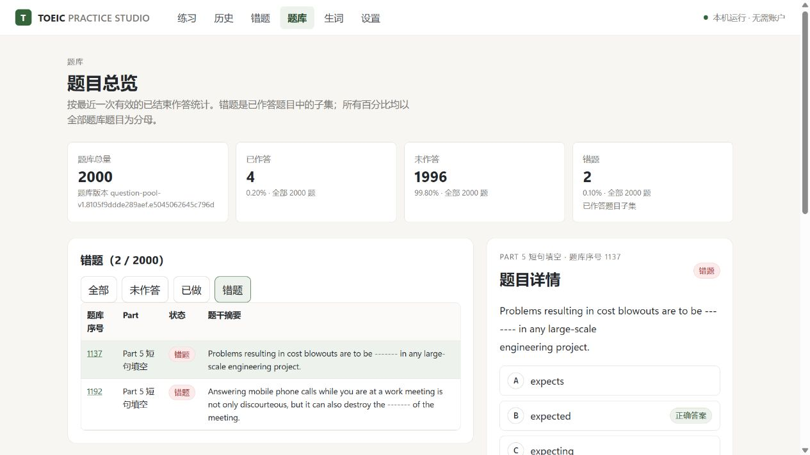

> **AI 辅助开发说明：本项目主要由 Codex 配合 GPT、Kimi、MiniMax、DeepSeek 等模型完成。** 需求、功能取舍与发布由维护者决定；AI 辅助生成的代码、排版和文档均可能存在错误。使用前请阅读下方[完整声明](#完整声明)。

# TOEIC Practice Studio

在本机浏览器运行的英语听力与阅读练习工具。无需账户，按完整对话和文章随机组卷，帮助个人进行分项训练、限时练习与错题复盘。

**2000 道题 · 1030 个完整题组 · Part 1–7 · 听力 45 分钟 / 阅读 75 分钟 / 完整 120 分钟**

> 本项目仅提供受限的个人非商业学习许可。仓库中的第三方练习内容未附带再分发授权证明；免费、非营利和公开可下载均不能替代内容授权。请先阅读[使用条款](LICENSE.md)、[内容权利说明](CONTENT-NOTICE.md)与[完整声明](#完整声明)。

## 目录

- [项目简介](#项目简介)
- [功能与预览](#功能与预览)
- [快速开始](#快速开始)
- [使用指南](#使用指南)
- [数据与备份](#数据与备份)
- [常见问题与限制](#常见问题与限制)
- [文档与架构](#文档与架构)
- [开发与验证](#开发与验证)
- [问题反馈与贡献](#问题反馈与贡献)
- [完整声明](#完整声明)
- [致谢与参考](#致谢与参考)

## 项目简介

TOEIC Practice Studio 面向本机、单人学习场景。题库以单题、完整对话或完整文章作为抽题单位，每轮重新选择和编号；同一材料下的多道题始终一起出现，保留材料与答案之间的对应关系。

程序通过本机服务与浏览器使用，学习数据写入本地 SQLite。核心练习功能无需模型 API Key，也不需要云端账户。当前发行入口为 Windows；本服务仅监听 `127.0.0.1`，不提供公网多人服务。

## 功能与预览

| 功能 | 当前行为 |
| --- | --- |
| 随机组卷 | 完整卷、仅听力、仅阅读、Part 1–7 专项、自定义各 Part 题数；完整材料不拆题 |
| 选题偏好 | 未做优先、错题优先、已做优先、全随机；优先题不足时从其余题目补齐 |
| 答题工作区 | 鼠标选答、文字复制、答题卡跳转、固定标记按钮、刷新恢复；自动下一题默认开启，可关闭 |
| 精确计时 | 以服务端截止时间和单调时钟计时；练习可暂停，严格模拟按阶段锁定答案 |
| 听力练习 | 单题或单篇重放、暂停、前后 10 秒、拖动进度；严格模拟关闭这些控制 |
| 逐句字幕 | 英文句子高亮、自动跟随、点击定位；中文默认隐藏，点击后再显示；仅练习与交卷复盘开放 |
| 交卷与复盘 | 自动判题，显示正确、错误、未做及比例；交卷进入统计，切回答题布局即可复盘，错误题号标红 |
| 用时分析 | 逐题与分 Part 曲线、首次选答前的停留时间；无历史数据时明确标为不可用 |
| 分页题库 | 答题卡式题号网格、状态数量与百分比；点击悬浮详情，主动选择后显示完整题解 |
| 文本排版 | 安全 Markdown、段落留白、分级标题、可选取表格；保留必要照片与图示 |
| 生词积累 | 通过用户确认的错因累计，支持撤回和掌握标记，避免仅因同词重复出现就算生词 |
| 本机数据 | 保留多轮作答、冻结历史报告，支持学习数据备份与恢复 |

以下图片来自隔离验收环境中的示例记录，不代表使用者真实成绩或官方计分。




## 快速开始

### 环境要求

| 项目 | 要求 |
| --- | --- |
| 系统 | Windows 发行入口；其他系统尚未完成安装验收 |
| Python | 3.12 或更新版本，能够在终端使用，或提供解释器路径 |
| Node.js | 24 或更新版本，包含 npm |
| 网络 | 首次安装需要下载依赖；日常核心练习不依赖云服务 |

### 安装与启动

克隆仓库，也可以下载并解压到本地可写目录。保持 `apps/`、`content/` 和启动文件的目录结构完整。

```powershell
git clone https://github.com/sbljsc/toeic-practice-studio.git
cd toeic-practice-studio
.\Setup.cmd
.\Start.cmd
```

不使用终端时，先双击 `Setup.cmd`，完成后双击 `Start.cmd`。首次安装会建立项目内的 Python 环境、安装锁定依赖并构建网页。

启动后浏览器打开 [本机练习页](http://127.0.0.1:8765)。保留启动窗口；结束时在该窗口按 `Ctrl+C`。

### 启动选项

```powershell
# Python 不在 PATH 中：将下面的占位路径换成实际解释器路径
.\Setup.cmd "Python安装目录\python.exe"

# 默认端口被占用
.\Start.cmd --port 8766

# 只启动服务，手动打开浏览器
.\Start.cmd --no-browser
```

首次启动的学习记录为空。发行包运行不依赖原始资料目录，也不需要维护者的磁盘路径。

## 使用指南

### 选择题目与模式

在「练习」选择范围、选题偏好和模式后开始。完整卷与听读分区采用固定题量：

| Part | 题型 | 完整卷题数 |
| --- | --- | ---: |
| 1 | 图片描述 | 6 |
| 2 | 应答问题 | 25 |
| 3 | 对话 | 39 |
| 4 | 独白 | 30 |
| 5 | 句子填空 | 30 |
| 6 | 篇章填空 | 16 |
| 7 | 阅读理解 | 54 |
| 合计 | 听力 100 题、阅读 100 题 | 200 |

Part 7 保留单篇、双篇、三篇材料结构。专项可输入目标题数；自定义模式逐 Part 设置，0 表示不选择。Part 3/4 题数须是 3 的倍数，Part 6 须是 4 的倍数；Part 7 按完整材料组合，不能凑足时会明确提示。

练习可重复开始，每轮有独立记录；新随机练习重新抽题，「按原题序精确重做」沿用原题序和快照。

### 计时与听力

| 范围 | 练习默认倒计时 | 严格模拟固定时长 |
| --- | ---: | ---: |
| 听力 | 45 分钟 | 45 分钟 |
| 阅读 | 75 分钟 | 75 分钟 |
| 完整 | 120 分钟 | 120 分钟 |

练习可保存自己的时长并暂停。严格完整模拟在听力结束后进入阅读，锁定听力答案；模拟中禁止暂停、拖动音频、查看答案与字幕。

随机听力使用原速的完整正式题目片段，移除原套题报号及与当前题目无关的片头、翻页和结束提示。保留正式内容、选项字母与正常答题间隔，不变速，也不截断题目来凑时间。所抽音频超过听力时段时重新抽取或明确拒绝；提前播放结束仍等到阶段截止。

刷新、切后台或重播不会增加考试预算。服务重启、媒体异常等会记录中断状态，不把不连续播放的模拟误算为完整模拟。

### 作答与交卷

选择答案后默认自动进入下一题，可关闭自动跳题；末题不会自动交卷。答题卡支持题号跳转与标记。

工作区顶部的「答题／统计」切换不改变题序、答案和计时阶段。交卷前的统计视图隐藏答案键和实时成绩；交卷后自动进入统计，可查看成绩、逐题或分 Part 用时，再切回「答题」复盘。复盘选项只读，答题卡错误题号标红，仍可编辑错因和生词证据。

用时统计来自服务端收到的前台题目标注，可能受网络延迟或离线影响。每次目标采用 15 秒租约，这不代表累计误差上限。页面暂停、切到后台或统计页时会发送空目标；旧记录不补猜过去，显示「部分覆盖」或「不可用」。考试截止时间独立于这些观察数据。

### 题库状态与生词

「题库」按稳定题目身份去重，取最近一次**有效、已结束且实际选了答案**的作答更新状态。未答交卷、仅标记或浏览不计为已做；中断而无效的模拟不覆盖有效记录。

**已做 + 未做 = 2000；错题是已做的子集。** 三项百分比均以全部题库为分母，显示两位小数。正确重做后，原错题退出错题集合。

点击分页网格中的题号可看只读详情，关闭后保留页码和筛选。题解默认隐藏，需点击「显示完整解析」；浏览题目不会新增作答或词汇证据。严格模拟期间完整题解锁定。

只有你确认「确实因这个词答错」，该词才累计错因。默认至少涉及 3 道不同错题、2 篇不同材料后列为必背；同一词在多道错题中出现本身不会触发，支持撤回证据和标记掌握。

### 文本与历史题号

题目序号和材料主标题采用 Markdown 三级标题，小标题采用四级标题，中文译文按原稿保留相应层级。正文段落自然衔接并留白；地址、邮件字段、对话、表格保留必要结构，词汇注释按词条与释义成组分段。必要照片和图表继续保留。

题干、选项、材料、字幕、译文、解析和词汇说明使用安全的 Markdown 显示规则。页面不执行原始 HTML，也不主动加载材料中的远程内容；选项与逐句字幕仅使用行内格式。

题库查找序号与每轮练习题号分开。Part 6 的填空通过稳定题目身份绑定到当轮题号。旧记录的题序、答案与成绩继续冻结；显示修复须完整源文本及编号关系匹配，不按旧题号猜测归属。为兼容较早快照，保留已转换为文本的注册题图资产。

本轮全库核对覆盖 2000 道题的 16,830 个非空文本字段，结合原稿疑点复核和实际页面验收；范围、结果与限制见[验收记录](docs/acceptance.md)。

## 数据与备份

学习答案、历史、生词和备份保存在项目 `.data/` 中；题库随 `content/question-pool/` 分发。请自行保管备份，不要向仓库提交 `.data/`、`.env`、个人数据库或备份文件。

- 在「设置」创建学习数据备份，也可选择包含题库。
- 恢复前会创建恢复前备份；正在计时的练习会阻止恢复。
- 服务运行时不要只复制 SQLite 主文件；请使用界面备份。
- 更新前先备份并停止服务，保留自己的 `.data/`；更新代码后重新运行 `Setup.cmd` 和 `Start.cmd`。

答案未确认保存时界面会提示，并保留本机待提交草稿。截止后的草稿不会回写成绩或混入新一轮。同一轮由一个标签页写入，版本冲突需明确选择保留的答案。

## 常见问题与限制

| 问题 | 说明 |
| --- | --- |
| 启动提示缺少环境或网页构建 | 检查 Python / Node.js 版本，运行 `Setup.cmd`；详细错误见启动窗口 |
| 默认端口被占用 | 使用 `Start.cmd --port 8766` |
| 为什么错题百分比与已做不同 | 错题是已做子集，比例统一除以全部题库总量 |
| 为什么旧报告没有用时曲线 | 旧记录没有可验证的历史观察值，程序不补算过去 |
| 为什么音频长度未填满 45 分钟 | 完整题目片段按原速播放，模拟阶段仍按固定截止时间结束 |
| 能导入 PDF、Word 等题目吗 | 初版暂不提供通用文件导入 |
| 能部署为公共网站或多人同步吗 | 当前是本机单人应用，不提供账户、云同步或公网多人服务 |
| 成绩能换算官方分数吗 | 当前只提供练习统计，不提供官方计分或分数换算 |

安装验收使用维护者现有 Windows 环境；未声称已在全新 Windows 或其他系统完成安装验证。自动检查不等于人工听完全部音频或重新完整运行 120 分钟。

## 文档与架构

| 文档 | 内容 |
| --- | --- |
| [架构与接口](docs/architecture.md) | 题库边界、组卷、冻结快照、计时、状态、备份和主要接口 |
| [验收记录](docs/acceptance.md) | 数据检查、运行验证、浏览器验收与覆盖限制 |
| [使用条款](LICENSE.md) | 自有代码的个人非商业许可范围 |
| [内容权利说明](CONTENT-NOTICE.md) | 第三方练习内容的权利、授权现状与处理渠道 |
| [软件依赖声明](THIRD-PARTY-NOTICES.txt) | 第三方软件版权和许可证 |

```text
apps/web/              React + TypeScript 网页
apps/api/              FastAPI 本机服务
content/question-pool/ 题目、材料、图片与听力片段
.data/                 个人学习数据与备份，不入库
tests/api/             后端回归测试
tools/check_bundle.py  题库与发行边界检查
Setup.cmd              安装锁定依赖并构建网页
Start.cmd              启动本机服务与浏览器
```

后端使用 SQLite，分别管理组卷、不可变作答快照、判题、截止时间、媒体、词汇证据与备份。服务只监听本机，写操作校验来源，媒体只从已注册资产读取。

## 开发与验证

先运行 `Setup.cmd` 安装项目环境，然后按需执行：

```powershell
npm run web:check
npm run web:test
npm run web:build
.venv\Scripts\python.exe -m pip install pytest==8.4.2 httpx==0.28.1
.venv\Scripts\python.exe -m pytest tests/api -q
.venv\Scripts\python.exe tools/check_bundle.py
```

发行版测试覆盖运行功能。依赖私有原资料的排版、音频等准备检查在维护环境执行，准备环境、来源对照和个人验收数据库不随仓库分发。少数原资料检查缺少资料时会明确跳过，不能描述为通过。

修改题库或程序时，应保持完整题组、稳定身份、冻结历史、服务端截止时间、原速音频及正常答题间隔，运行与改动相关的回归与发行检查。

## 问题反馈与贡献

欢迎通过 [Issues](https://github.com/sbljsc/toeic-practice-studio/issues) 反馈问题，或提交范围明确的代码修复。

反馈请包括操作步骤、预期与实际结果、题库序号、必要截图和错误信息。涉及题库时优先提供稳定题目身份或题库序号，避免只用某轮随机题号定位。

提交修改前请阅读使用条款，说明修改目的与验证结果。请勿附带个人数据库、备份、凭据、私人路径或未经授权的第三方材料；涉及练习内容的新增或替换，应先明确来源、权利和可分发范围。

## 完整声明

### AI 辅助开发

本项目主要由 **Codex 配合 GPT、Kimi、MiniMax、DeepSeek 等模型**完成。模型参与需求分析、架构、代码、文档、界面设计和交叉检查；Kimi、MiniMax 在本项目中用于界面设计相关工作。维护者负责提出需求、确定取舍与决定发布。

AI 生成结果和交叉检查均可能有遗漏。模型参与不代表模型提供方审查、担保、赞助或认可本项目。AI 参与发生在开发过程；核心练习功能通过本机服务运行，无需模型 API Key。

### 项目定位与非官方关系

本项目用于个人英语听力和阅读练习，不提供官方考试、证书、成绩认证或官方分数换算。

项目名称中的考试标识用于说明练习类型。项目与任何考试机构、出版方或培训机构不存在已声明的隶属、合作、赞助或授权关系；相关名称、标识和商标的权利归各自权利人。

### 第三方内容及授权现状

题目、文章、解释、译文、图片和录音的权利归各自权利人。**维护者目前未提供覆盖这些第三方内容的再分发许可证或授权证明。**

移除包装与名称、重排题目、转换文字、剪去报号或由 AI 协助整理，不改变原有权利归属。仅供个人学习、免费、非营利或禁止商用声明，不能替代第三方内容授权；仓库公开、可克隆或可下载也不授予题库再分发权。

请在合法取得且获相应授权的范围内使用材料。代码条款、文档声明与第三方内容的权利分别处理，详见[内容权利说明](CONTENT-NOTICE.md)。

### 个人非商业使用范围

[使用条款](LICENSE.md)仅对维护者有权许可的自有程序代码，允许个人为非商业学习目的运行、复制和修改。分发自有代码时须保留条款与相关声明。

禁止将该许可范围内的代码用于销售、付费托管、广告变现或商业培训。第三方练习内容的复制、分发、商业利用或训练产品使用，须另行具有相应权利，代码许可不授予这些内容的使用或分发权。

本项目采用受限的个人学习许可，**不是 OSI 认可的开源许可证**。不得把整个仓库标记为 MIT、Apache 等许可证，从而误称第三方内容已获得相应授权。

### 软件依赖与权利保留

React、FastAPI 等第三方软件继续适用各自许可证。相关版权、许可和免责信息须保留，详见[软件依赖声明](THIRD-PARTY-NOTICES.txt)。

AI 参与、仓库可访问以及自有代码条款均不取消第三方的软件许可要求或内容权利。

### 隐私与本机服务

学习记录默认保存于本机 `.data/`，由使用者自行管理和备份。当前不提供云端账户或多人同步；首次安装需联网下载依赖，日常核心练习无需云服务。

主动上传到 GitHub Issue、Pull Request 或其他外部平台的信息，由相应平台按其规则处理。请在提交前删除个人数据库、备份、凭据、私人路径及不必要的个人信息。本机服务应保持本机使用，不应直接暴露到公网。

### 准确性与责任限制

项目按现状提供。AI 输出、原稿、题库整理、解析、字幕、计时和统计均可能存在错误；自动检查与人工疑点复核不能保证完全无误。练习表现也不保证与正式考试等值。

请保留重要学习数据的备份，并参考[验收记录](docs/acceptance.md)了解已验证范围、跳过项和环境限制。在适用法律允许的范围内，保证与责任限制按[使用条款](LICENSE.md)执行；本声明不排除适用法律中不可排除的责任。

### 权利人联系与争议处理

权利人可通过[仓库 Issue](https://github.com/sbljsc/toeic-practice-studio/issues)或[维护者 GitHub 页面](https://github.com/sbljsc)提出处理请求，说明受影响的文件或题库序号、权利依据和希望采取的措施。

公开反馈请勿上传身份证件、合同等敏感证明；如需核验，请先请求适当的私下联系渠道。维护者应核实请求，并根据具体情况对争议内容采取删除、替换或限制分发等措施。

## 致谢与参考

感谢参与开发与检查的工具、模型，以及 React、TypeScript、Vite、FastAPI、SQLite 等软件生态。

本文档的组织方式参考了大型项目的官方 README：

- [Vite](https://github.com/vitejs/vite/blob/main/README.md)：项目简介、功能、文档、贡献与许可入口。
- [FastAPI](https://github.com/fastapi/fastapi/blob/master/README.md)：环境要求、安装、使用示例与详细文档衔接。
- [Immich](https://github.com/immich-app/immich/blob/main/README.md)：重要说明、文档导航、功能表格与预览。

以上为文档组织参考；软件依赖及第三方内容的权利说明以对应声明文件为准。
