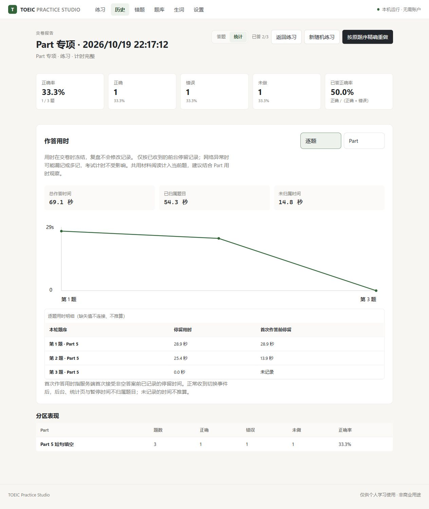

# 发行验收记录

此前综合验收日期：2026-10-19。下表保留前轮验收依据，后续全库排版与公开发布验收另记于后。维护者已明确授权在本轮验收完成后公开仓库。

| 验证范围 | 结果与依据 |
| --- | --- |
| 题库完整性 | 2000 道题、1030 个完整材料组；本轮题目、选项、答案、题组关系、音频和字幕均与整理前一致 |
| 文本与表格 | 核对 96 张非 Part 1 图片，将 40 张阅读和 40 张听力文字／表格图片转换为可选取文本，保留 16 张必要图示及全部 60 张 Part 1 照片；旧记录通过已核验的图片编号映射改善显示，数据库快照不改写 |
| 材料回归 | 10 项解析器／真实组件渲染回归、5 项规范化回归通过；核验表格行列、勾选、金额、动态题号、HTML 惰性显示和受控图片地址；题库加载与校验通过 |
| 答题工作区 | 浏览器验证自动下一题默认开启，可关闭；末题不自动交卷；标记按钮两题间位置相同；没有清空按钮；每个答题卡格只显示一个题号 |
| 统计与复盘 | 交卷默认显示统计，成绩摘要在曲线之前；1 正确／1 错误／1 未做均为 33.3%，已答正确率 50%；复盘复用作答布局，错误题号标红、选项只读、错因保存成功 |
| 用时记录 | 15 项活动记录回归通过，涵盖停留／首次选答、暂停、统计页、租约、会话序列、接管、阶段截止、重启、旧记录及真实文件备份恢复；旧用时不补猜，交卷后冻结。配合备份回归共 23 项通过 |
| 真实 HTTP | 独立服务验证前台／统计归属、暂停排除、成绩、逐题／Part 汇总及报告冻结；单独构造旧格式报告，浏览器显示未记录提示 |
| 分页题库 | 浏览器验证每页 100／50 题、页码与筛选边界、错题筛选、悬浮详情、Esc 关闭和焦点恢复；关闭后音频卸载，题库浏览不新增答题 |
| 听力回归 | 原速 1× 播放，自动跳题时当前片段由 22.655 秒继续到 22.940 秒；切统计继续播放和计时，模拟期间不展示字幕或题解；练习／复盘英文句子点击定位与高亮、中文默认隐藏通过 |
| 文本复制与窄屏 | 实际复制内容包含表格项目及总额；390px 窄屏按钮不再挤成竖排，页面无横向溢出，多列表格在独立容器横向滚动；听力／阅读／完整预设 45／75／120 分钟通过 |
| 自动检查 | 维护项目 API 355 通过；独立发行 API 314 通过、10 项原资料检查明确跳过；网页 185 通过，类型检查与生产构建通过 |
| 独立发行运行 | 实际运行发行目录的 Start，完成单题组卷、作答、暂停／恢复和交卷统计；生产网页与维护项目构建一致，发行包校验通过，含 540 段音频、3408 句字幕 |
| 学习数据 | 本机原有 3 条已交卷记录、题目／题组快照、答案及成绩逐项与更新前备份一致；验收使用隔离数据库 |
| 独立最终审查 | APPROVE，无剩余实质问题；两个历史／恢复边界问题已重现并修复，复查通过。材料内容由实施者逐图核验，终审采用抽样检查 |
| 发行边界 | 未复制个人数据库、备份、原始书籍、准备缓存、来源对照或凭据；保留软件依赖许可证与内容权利说明；前轮发布时仓库为私有 |

后续文本排版改进：题干、选项、阅读材料、题解、译文、听力文本及生词释义／例句共用安全 Markdown 显示。网页 199 项检查、类型检查和生产构建通过；其中 22 项材料解析／实际渲染回归涵盖软换行、中英文数字、选项括号、姓名中点、补充例句、邮件地址、显式硬换行和历史动态题号。对题库 13,346 段非空文本与上一版解析结果进行对比，非空白字符无差异；这项检查验证文字保留，不等同于人工逐段核对原稿段落。浏览器检查正文、题解、地址、表格、390px 窄屏及字幕点击定位／中文开关通过。此改进只修改显示，未改写题库或学习数据；独立复查发现的排版问题均已修复。

## 全库文本、题号与标题检查

本轮题库版本为 `question-pool-v1.e1228ac504a86d0e.2e7ea3ced729a612`。检查覆盖全部 **2000 道题、1030 个题组**，包含题干、7750 个选项、2000 份题解、材料与译文、540 组听力文本、3408 句字幕及图片说明，共 **16,830 个非空文本字段**。

检查分别处理内容、题号和显示结构：逐项对照已核验的源数据与题库身份、答案和题组关系，再通过实际 React 渲染器检查文字保留、单词边界、选项、列表编号、表格及标题。原 PDF 的字体、缩进、行距和位置用于确定段落与必要换行；明确的标题输出为三级或四级 Markdown 标题。它们是自动覆盖和针对疑点的原页核对，**不等于人工逐字重读 2000 道题或逐页看完原书**。

修复包含软换行误断、姓名中点和日期拆行、列表分组、下划线填空被识别为强调，以及材料和中文译文中遗漏的主标题、小标题。270 个明确标注的词汇块、5571 个词条按词条与释义成组分段，避免不同词条挤在同一段。一处 Part 6 填空标签未绑定题目身份，现已更正；40 个 Part 6 题组的全部 160 个填空均有明确对应。题目身份、选项、答案键、题组成员、音频和字幕没有因此更改。

为检验旧记录兼容性，隔离验收创建了包含全部 160 道 Part 6 的已交卷旧格式快照：原文仍保存旧标签 `(140)`，页面依照该轮冻结题序正确显示为 `(90)`，查看后数据库和 API 快照仍保留原文，成绩不重算。显示修复要求完整源文本、稳定身份和其他题号同时匹配；不匹配时不猜测。

维护项目 API **355 项通过**；独立发行 API **314 项通过、10 项依赖原资料的检查明确跳过**；网页 **224 项通过**，类型检查与生产构建通过。维护环境的排版编译器回归通过，全部 3542 份排版描述通过实际显示函数重放。发行检查核对题库、资产登记与哈希、文档链接及提交内容，并在公开前完成独立复核。实际浏览器检查包括标题层级、段落留白、必要地址换行、表格窄屏滚动、字幕定位和中文默认隐藏。正常学习数据库与正在进行的练习不参与隔离验收。

全库文字检查没有发现剩余字符丢失或题号对应问题。原始 DOM 文字对比有 16,827 个字段一致、3 个字段不同；这 3 处的差异均来自列表序号由字面文字改为浏览器列表标记，已另行核对可见编号顺序，并非丢字。答案证据也存在明确限制：8 道题没有可直接独立提取的答案字母，本轮沿用此前语义核验结果；原稿的已确认排印更正和措辞差异继续保留，未自行重写题目或答案。

## Windows x64 便携发行

便携包将官方 CPython 3.14.8 嵌入式运行时、锁定依赖、已构建网页和同一份题库一起分发。构建前核对官方 SHA-256；本机还核对了 `python.exe` 与 `python314.dll` 的 Python Software Foundation 有效数字签名。运行时使用隔离的模块路径，不读取系统或用户的 Python 包，包内不包含 Node.js、pip 安装入口或个人 `.data/`。

维护环境从实际生成的 ZIP 解压到含中文和空格的目录，将子进程 `PATH` 限制为 Windows 系统目录，并设置无效的 `PYTHONHOME`、`PYTHONPATH`。验证系统 Python / Node.js 均不可见，`Start.cmd` 仍能启动本机服务，所有 Python 依赖从包内加载。实际 HTTP 验证题库 2000 题／1030 组、首次空学习数据、原速 FLAC Range 读取、创建练习、答题、暂停／恢复和交卷；3 题样例为 1 正确／1 错误／1 未做，各 33.3%，已答正确率 50%。文件备份下载哈希、恢复及恢复前备份通过，跨来源写操作被拒绝。

浏览器实际显示交卷摘要与用时曲线，并验证包内音频能够以 1× 解码播放、暂停、点击英文句子定位及高亮，中文字幕默认隐藏。验收使用便携包内新建的隔离学习数据，未读取或更新维护者原有学习数据库。

构建工具 19 项检查通过，包含版本一致性、路径／链接越界、私有文件排除、重复文件、输出冲突、CRC 失败及校验文件发布失败的回退。独立审查发现并修复的四处问题是版本标签不一致、网页可能未重新构建、缓存路径检查时机和 ZIP／校验文件的发布顺序。修复后的完整试构建、ZIP CRC 与 SHA-256 检查通过。API 本轮重新执行为 314 通过、10 项原资料检查跳过。

正式发行必须从已提交、干净的代码重新构建；构建器自动使用锁文件安装网页构建依赖并构建，记录来源提交、工具版本、网页哈希和运行时信息。`--allow-dirty` 仅供本地试构建，不得发布其产物。发布资产的最终信息和校验文件以对应 GitHub Release 为准。

这项验收使用现有 Windows 主机上的隔离目录和进程环境，不等同于全新 Windows 虚拟机或所有 Windows 10/11 设备验收；没有提供签名的自定义安装器，也不保证 SmartScreen 或企业安全策略的行为。

## 验证限制

本轮未新做 120 分钟实时完整模拟，也未人工听完全部录音。原有 540 段音频的边界与 PCM 校验结果保持有效，本轮未改写音轨、语速或正常答题间隔。网络异常或请求延迟可能使逐题停留统计漏记或多记；15 秒租约只约束每次收到的目标，不代表总误差上限。考试倒计时仍由服务端截止时间控制。

独立目录使用本机已有 Python／Node 环境；不声称在全新 Windows 机器上重新安装过。10 项发行 API 跳过项依赖未分发的原资料，不能描述为通过。

下面是隔离验收记录，非使用者真实成绩。详细日志、图片逐项核验、时钟与浏览器证据保留在维护环境，不随仓库上传。

